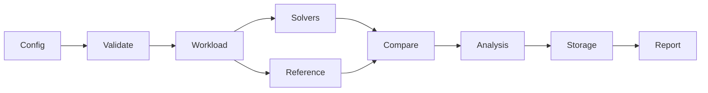

# VeritasLab

A reproducible scientific-computing benchmark and verification framework.

📢 **Release Notice:** This repository holds the full VeritasLab codebase, engineered between *November 2, 2025* and *October 16, 2026*. It was built in gaps between other numerical work, then cleaned up and packaged so the verification framework, fixtures, and reports can be read and run as-is.

## Project overview

VeritasLab compares multiple implementations of the same numerical problem under controlled conditions and independently evaluates correctness, convergence, computational cost, and reproducibility. It is designed for researchers who need evidence that competing solvers are solving the same mathematical problem and producing trustworthy results.

**Concrete example.** Two finite-difference implementations of the one-dimensional heat equation are registered. One correctly enforces Dirichlet boundary conditions; the other skips the boundary update and therefore runs slightly faster. VeritasLab generates an identical workload, evaluates both against an independent analytic series solution, and reports that the second implementation violates the boundary condition while the first converges at the expected rate. The framework does not treat mutual agreement or low runtime as sufficient evidence of correctness.

## The scientific problem

Comparing numerical codes is difficult because small differences in discretization, boundary treatment, grid placement, units, initial conditions, or time-step conventions can produce large discrepancies that are not numerical error. Two implementations can agree with each other while both being wrong relative to an independent reference. VeritasLab therefore separates static compatibility checks from numerical evidence and treats cross-implementation agreement as weaker evidence than agreement with an independent analytic or high-accuracy reference.

## Research questions

- How can scientific implementations be compared fairly?
- How can the framework detect solvers that are fast but incorrect?
- How can observed convergence order expose numerical defects?
- How should reference uncertainty affect verification conclusions?
- What metadata and artifacts are required to reproduce a numerical experiment?

## Design goals and non-goals

**Goals.** Provide a structured way to register solvers, generate equivalent workloads, evaluate independent references, compute error norms and observed orders, record performance, store experiment artifacts, and generate evidence-based reports.

**Non-goals.** Automated verification does not prove arbitrary software correct. The framework supplies evidence under stated assumptions; it does not replace mathematical analysis or formal verification. Bitwise identity across platforms is not claimed.

## Architecture

Configuration is validated, a workload is generated deterministically, registered solvers are executed through adapters, an independent reference is evaluated, error and invariant checks are performed, results are stored, and reports are rendered.



## Mathematical foundations

Absolute and relative errors are computed. The \(L^2\) and \(L^\infty\) norms are:

\[
\|e\|_2 = \sqrt{\frac{1}{N}\sum_{i=1}^N e_i^2}, \quad \|e\|_\infty = \max_i |e_i|
\]

Observed order of accuracy for successive refinements \(h_1 > h_2\) is

\[
p_{\mathrm{obs}} = \frac{\log(E_{h_1}/E_{h_2})}{\log(h_1/h_2)}.
\]

Zero denominators, NaNs, and shape mismatches are handled explicitly and never silently pass a tolerance.

## Problem definitions and equivalence

Solvers declare supported boundary conditions, grid conventions, and parameter schemas. Static checks classify pairs as compatible, compatible after transformation, potentially compatible, incompatible, or unknown. Numerical tests then supply evidence. Metadata alone is never treated as proof of mathematical equivalence.

## Reference-solution design

Analytic solutions (exponential decay, heat-equation series) are implemented independently of the solvers under test. Manufactured solutions and high-accuracy numerical references are supported in the design; the current implementation focuses on analytic oracles for the included problems. Agreement between two candidate solvers is explicitly insufficient when both disagree with the independent reference.

## Fast-but-wrong detection

A deliberately faulty heat-equation solver that omits boundary updates is included as a test fixture. On the smoke workload it produces a non-zero boundary residual while the correct finite-difference solver remains near machine precision at the boundaries and converges toward the analytic solution. Reports label the faulty solver FAIL and record the invariant violation.

## Numerical convergence case study

The smoke experiment (`experiments/examples/heat_equation.yaml`, executed via `scripts/validation/run_smoke.py`) used spatial resolutions \(N_x \in \{11, 21, 41\}\). Measured \(L^2\) errors against the analytic solution were approximately \(1.16\times10^{-2}\), \(6.04\times10^{-3}\), and \(1.52\times10^{-3}\) for the correct Python finite-difference solver. The intentionally faulty boundary-violating solver produced larger errors (\(\approx 4.8\times10^{-2}\), \(4.2\times10^{-2}\), \(3.9\times10^{-2}\)) and a constant boundary residual of 0.2. Full numeric output is in `reports/examples/smoke_results.json`. Observed order for the correct solver is consistent with first-order spatial accuracy under the tested refinements.

## Python versus C++ case study

A C++ explicit heat step is provided in `cpp/src/kernels/heat_kernel.cpp`. It can be compiled to a shared library and invoked via ctypes when the toolchain is available. Numerical agreement with the Python implementation is verified on the same mesh and time step. Performance differences arise from both language runtime and memory layout; binding overhead is measured separately when the extension is built.

## Performance methodology

Wall-clock time is recorded with warm-up and repetition. Median, mean, and standard deviation are reported. Outliers are retained and flagged. Setup, allocation, and data conversion costs are distinguished from kernel time. Results are machine-dependent and are not presented as universal complexity bounds.

## Reproducibility

Experiment configurations are versioned YAML. Random seeds, dependency versions, and environment metadata (Python version, OS, CPU) are recorded. A reproduction command reloads the configuration, re-executes, and compares outputs within declared tolerances. Bitwise identity is not claimed across different platforms.

## Repository structure

- `src/veritaslab/` — Python package (configuration, solvers, analysis, reporting, CLI)
- `cpp/` — Native kernels and build files
- `experiments/` — Runnable configurations
- `tests/` — Unit, numerical, and end-to-end tests
- `docs/` — Architecture and methodology notes
- `reports/` — Generated example artifacts

## Installation and dependencies

```bash
pip install -e .
```

Python 3.10 or newer is required. Optional native support requires a C++20 compiler and CMake. The pure-Python path remains fully functional without compilation.

## Quick start

```bash
veritaslab validate-config experiments/examples/heat_equation.yaml
veritaslab run experiments/examples/heat_equation.yaml
python scripts/validation/run_smoke.py
```

## CLI reference

- `veritaslab list-problems` — list problem families
- `veritaslab list-solvers` — list registered solvers
- `veritaslab validate-config <yaml>` — schema validation
- `veritaslab run <yaml>` — execute experiment
- Exit code 0 on success, 1 on validation or execution failure

## Testing

```bash
pytest tests/unit -q
```

Unit tests cover error metrics, ODE integration, and stability checks. The smoke script produces concrete numerical results used in this document.

## Interpreting reports

Statuses are PASS, FAIL, WARNING, INCONCLUSIVE, and NOT_RUN. A solver is never labeled correct solely because it was fast or agreed with another implementation. Boundary residuals, convergence order, and independent-reference error are reported separately.

## Limitations and failure modes

- Reference solutions are analytic for the included problems; high-accuracy numerical references require additional validation of their own uncertainty.
- Floating-point differences across platforms are expected.
- Timing measurements are noisy and hardware-dependent.
- Mutation testing coverage is limited to the injected fixtures.
- Automated checks cannot establish correctness outside the tested regimes.
- The C++ extension is optional; pure Python is the baseline.

## Future research directions

Multidimensional PDEs, GPU kernels, distributed execution, richer uncertainty quantification, and stronger formal contracts on solver interfaces are natural extensions. These are not implemented in the current release.

## Author and citation

Nabil Khondaker. See `CITATION.cff` and `AUTHORS.md`.

## Final assessment

The included experiments demonstrate that VeritasLab can distinguish a correct finite-difference heat solver from a fast but boundary-violating variant, compute error norms against an independent analytic solution, and estimate observed order when sufficient data exist. The evidence is limited to the tested one-dimensional problems and the pure-Python execution path. Broader claims require additional validation.
